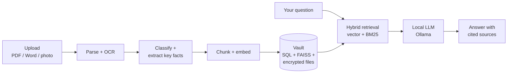

<div align="center">

# Document Vault

**A private, local-first vault for your important papers. Ask questions about them in plain English.**

Insurance policies, warranty cards, bills, property papers and ID cards: upload them once, then just ask.
Every model runs on your own computer. Nothing is sent to a cloud AI service.


-444444)


</div>

---

> **You:** When does my bike insurance expire?
> **Vault:** Your bike insurance expires on **14 March 2027** [1].
> *[1] Bike Insurance 2026.pdf, page 1*

Click a source and the original page opens with the answer highlighted on it.

## Highlights

- **Ask, don't search.** A chat that answers from your documents and cites the exact page.
- **Fully local.** Embeddings (Snowflake Arctic Embed), answers (Ollama) and OCR (Tesseract) run on your machine. The LLM client refuses any non-local address, and the web app loads nothing from the internet.
- **Hybrid retrieval.** Meaning (vector search) and exact words and numbers (BM25) are fused, so both *"when does my bike cover end"* and *"find policy KMI/PC/25/0093318"* work.
- **Reads scans and photos.** Auto-rotation, clean-up, English and Hindi OCR, locked PDFs (e-Aadhaar, e-PAN), HEIC photos.
- **Understands what it stores.** Documents are sorted by type, and expiry dates, due dates, amounts and reference numbers are extracted automatically.
- **Reminders.** Before expiries and due dates: phone notifications, Mac notifications, a calendar file and a dashboard.
- **Encrypted at rest.** AES-256-GCM for files, scans, search index, file names and ID numbers. The key lives in the macOS Keychain, with a paper recovery key and encrypted backups.
- **Automatic backups.** Scheduled encrypted backups to several places at once (second disk, USB drive, NAS share, cloud-synced folder). Every copy is re-opened and checked, and each location's result is shown in Settings.
- **Family-ready.** Password and passkey (Touch ID / Face ID) sign-in, per-person accounts, private or shared documents, and an activity log.
- **Web and phone.** A Next.js web app and a Flutter phone app paired by QR code over HTTPS with certificate pinning.

## How it works



| Layer | Technology |
|---|---|
| Backend | Python, FastAPI |
| Web app | Next.js, React, TypeScript (static export served by FastAPI) |
| Mobile | Flutter (Android and iOS) |
| Embeddings and search | Snowflake Arctic Embed, FAISS, BM25 with Reciprocal Rank Fusion |
| Answers | Ollama (default `llama3.1:8b`) |
| OCR | Tesseract |
| Storage | SQLite or PostgreSQL for records, FAISS for vectors, encrypted files on disk |
| Security | AES-256-GCM, macOS Keychain, scrypt, passkeys (WebAuthn) |

## Quick start

Runs on macOS. The samples are fictional, so you can try everything without any real papers.

**One command.** Install [Homebrew](https://brew.sh) and [Ollama](https://ollama.com) (open Ollama once), then paste this into Terminal:

```bash
curl -fsSL https://raw.githubusercontent.com/Abhinavchitturi/Document-vault/main/install.sh | sh -s -- --with-samples
```

It downloads the vault to `~/Document-Vault`, installs the Python packages, OCR and web app, pulls the answer model,
loads the sample documents, starts the vault and opens http://localhost:8000. Run it again any time to update.
Prefer to read it first? [install.sh](install.sh) is a short script. Add `--no-start` to set up without starting,
or run `./install.sh --with-samples` from a copy you cloned yourself.

**Or step by step:**

```bash
# 1. Python packages
python3 -m venv venv && source venv/bin/activate
pip install -r requirements.txt

# 2. Tesseract (scans and photos) and Node (builds the web pages)
brew install tesseract tesseract-lang node

# 3. A local answer model (install Ollama from https://ollama.com first)
ollama pull llama3.1:8b

# 4. Build the web app
cd frontend && npm install && npm run build && cd ..

# 5. Load the sample documents into a single-file database (no PostgreSQL needed)
export VAULT_DATABASE_URL=sqlite:///data/index/vault.db
python -m backend.upload.ingest samples/pdfs samples/scans --owner abhinav

# 6. Start the vault
./vault start
```

Open **http://localhost:8000** (the one-command install does this for you), choose a password on the first screen, and ask
*"When does my bike insurance expire?"*. The first run downloads the embedding model (about 440 MB);
after that everything works offline. Stop with `./vault stop`.

**Try an upload:** drag `samples/upload-demo/Laptop Warranty.pdf` onto the Upload page, then ask
*"When does my laptop warranty expire?"*. The locked card in `samples/scans/identity/` uses the
password `ARJU1988`.

**Not on a Mac?** `./vault` relies on macOS. On Linux, install Tesseract and Ollama with your package
manager, run steps 1, 3, 4 and 5, then start the server directly with `python -m backend.api.app`.
The encryption key is then kept in `~/.document-vault/keys/` instead of the Keychain.
Neither Linux nor Windows has been tested.

**If something doesn't work**

| Symptom | Fix |
|---|---|
| Header says **Assistant offline** | Open the Ollama app, then check `ollama list` shows `llama3.1:8b` |
| Scans or photos fail, or are "hard to read" | `brew install tesseract tesseract-lang` |
| Web pages missing at `localhost:8000` | Build the web app: `cd frontend && npm install && npm run build` |
| Want a clean start | `./vault stop`, delete the `data/` folder, repeat step 5 and `./vault start` |

| Command | What it does |
|---|---|
| `./vault start` / `stop` | Start or stop the vault in the background |
| `./vault status` | Check the database, Ollama, OCR, web pages and phone tunnel |
| `./vault logs` | Show the log (`-f` to follow) |
| `./vault update` | Pull changes, rebuild what changed, restart |
| `./vault autostart on` | Start at login |

## What's inside

| Page | Purpose |
|---|---|
| **Dashboard** | Counts by type, recent documents, upcoming expiries and due dates, quick ask box |
| **Chat** | Streaming answers with numbered sources and in-page highlighting |
| **Documents** | Filter and search, change type, view or open the original, share or make private |
| **Upload** | Drag and drop PDFs, Word files and photos; type is detected automatically |
| **Settings** | Answer model, theme, reminders, family members, phones, backups, activity log |

## Privacy and security

- **Local only.** No document text, question or embedding leaves the machine. The LLM client refuses non-local addresses.
- **Encrypted on disk.** Without the key, a copy of `data/` is unreadable. The key is in the macOS Keychain, never in the project folder.
- **Recovery and backups.** A paper recovery key and single-file encrypted `.dvbackup` backups.
- **Accounts.** Passwords stored only as salted scrypt hashes, HttpOnly SameSite cookies, lockout after repeated failures, passkey sign-in.
- **Phones.** Paired by QR code, served over HTTPS with the app pinned to the vault's own certificate. Remote access can use a private Tailscale tunnel; nothing is opened to the public internet.
- **Activity log.** Sign-ins, document access and changes, recorded without the words you typed.

The repository holds code and fictional samples only. Your own data lives in `data/`, which is git-ignored.

## Backups and disk failures

The vault lives on one Mac, so a dead disk would take it with it unless you keep backups elsewhere.

- **Automatic backups:** *Settings → Security → Automatic backups* (admin). Choose up to five locations, daily or
  weekly, and how many to keep. The first backup runs right away; each location's last result, or the reason it
  failed, is shown there.
- **Where to point it:** a second disk, a USB drive, a **NAS share mounted on the Mac** (for example
  `/Volumes/NAS/Backups`), or a cloud-synced folder such as iCloud Drive or Dropbox. Each backup is one encrypted
  `.dvbackup` file, so every location only ever holds ciphertext. Use more than one, on different disks: Settings
  warns when two locations share a disk, or one shares the vault's disk.
- **Every copy is checked.** After writing, the app reads each copy back and fully decrypts it. A bad copy is deleted
  and reported, and older backups are only pruned once a good one exists. One location failing (NAS off, drive
  unplugged) does not stop the others; it retries hourly and never creates a stray local folder.
  Check a file by hand with `python -m backend.security.cli verify "<file>.dvbackup"`.
- **Why the vault itself isn't on the NAS:** its database and search index are written constantly, and SQLite is
  not safe on a network share. The reliable design is a local vault plus backups on the NAS.
- **Restore** on any Mac, even a new one: `python -m backend.security.cli restore "<file>.dvbackup"`.
- **Keep the backup password somewhere else too.** It is saved on the Mac next to the vault key so backups can run
  unattended; without it a backup cannot be opened.

This is backup, not live replication: you can lose up to one backup interval of changes, and there is no RAID or
second live copy. Keep at least one backup off the Mac.

## Search quality

Measured on the bundled sample set (13 documents, 32 questions, 8 of them lookups by a policy or serial number):

| Method | Recall@1 | Recall@3 | MRR@5 |
|---|---|---|---|
| Vector only (Arctic Embed M v1.5) | 0.906 | 1.000 | 0.948 |
| Keyword only (BM25) | 0.938 | 1.000 | 0.969 |
| **Hybrid (default)** | **1.000** | **1.000** | **1.000** |

Reproduce with `python -m backend.eval.evaluate --show-misses`. The sample set is small and
synthetic, so read these as a sanity check rather than a benchmark.

## Project layout

| Path | Contents |
|---|---|
| `backend/` | FastAPI app, upload pipeline, parsing and OCR, classification, key-fact extraction, hybrid retriever, local LLM client, auth, security, reminders |
| `frontend/` | Next.js web app |
| `mobile/` | Flutter phone app ([setup](mobile/README.md)) |
| `samples/` | Fictional documents, scans, questions and the generators for them |
| `tests/` | Test suite |
| `docs/` | [User guide](docs/USER_GUIDE.md), [how it works](docs/HOW_IT_WORKS.md), [project brief](docs/PROJECT_BRIEF.md) |

## Development

```bash
pytest -q                          # tests use a fake embedder and LLM: no models needed
python -m backend.api.app          # API on :8000
cd frontend && npm run dev         # web app on :3000, forwarding /api to :8000
```

## Documentation

- **[User guide](docs/USER_GUIDE.md):** setup, running, sharing, reminders, phone pairing, backups
- **[How it works](docs/HOW_IT_WORKS.md):** architecture, upload and question pipelines, data model, API
- **[Project brief](docs/PROJECT_BRIEF.md):** vision, phases and design decisions

## Roadmap

Built in 13 phases, from a core RAG engine to a mobile app with family sharing and one-command
deployment; see the [user guide](docs/USER_GUIDE.md#status). Added since: automatic backups to several places
(each copy checked), and a one-command installer.

Not planned: a double-click Mac app. Without a paid Apple Developer account (about $99 a year) macOS warns on
unsigned apps, so installation stays a single Terminal command. Not done: running the live vault directly on
network storage (backups to a NAS work; SQLite does not belong on a network share).

## License

Released under the [MIT License](LICENSE).
