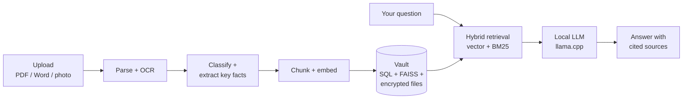

<div align="center">

# Document Vault

**A private, local-first vault for your family's important papers. Ask questions about them in plain English.**

[](https://github.com/Abhinavchitturi/Document-vault/actions/workflows/ci.yml)


-444444)


</div>

Insurance policies, warranty cards, bills, property papers and ID cards: upload them once, then ask.
Document Vault answers from your own documents, cites the exact page, and runs every model on your own computer.
Nothing is sent to a cloud AI service.

> **You:** When does my bike insurance expire?<br>
> **Vault:** Your bike insurance expires on **14 March 2027** [1].<br>
> *[1] Bike Insurance 2026.pdf, page 1 (click to open the page with the answer highlighted)*

## Download

| Platform | Download | Notes |
|---|---|---|
| **macOS** 12+ | [**DocumentVault-macOS.dmg**](https://github.com/Abhinavchitturi/Document-vault/releases/latest/download/DocumentVault-macOS.dmg) | Apple Silicon or Intel |
| **Windows** 10 / 11 | [**DocumentVault-Setup.exe**](https://github.com/Abhinavchitturi/Document-vault/releases/latest/download/DocumentVault-Setup.exe) | Beta |
| **Android** 7+ | [**DocumentVault-Android.apk**](https://github.com/Abhinavchitturi/Document-vault/releases/latest/download/DocumentVault-Android.apk) | Companion app: pairs with the vault on your computer |

All releases: [Releases page](https://github.com/Abhinavchitturi/Document-vault/releases).

The desktop downloads are small installers. On first launch they download the vault and set it up: Python
packages, the web app, the AI engine (llama.cpp) and the AI models (about 6 GB in total, 10 to 30 minutes, once). Plan for **8 GB of RAM
(16 GB recommended)** and **10 GB of free disk space**.

> **About security warnings.** The installers are not code-signed, because signing needs paid Apple and Microsoft
> developer accounts. Your computer will warn you the first time:
> - **macOS:** open the app, then go to *System Settings → Privacy & Security* and choose **Open Anyway**.
> - **Windows:** on "Windows protected your PC", choose **More info → Run anyway**.
> - **Android:** allow installs from your browser or file manager when asked.
>
> The installers download the open-source code in this repository and nothing else. If you prefer, read
> [`install.sh`](install.sh) / [`install.ps1`](install.ps1) and install from the command line (below).

## Highlights

- **Ask, don't search.** A chat that answers from your documents and cites the exact page, with the answer highlighted on the original.
- **Fully local.** Embeddings (Snowflake Arctic Embed), answers (Llama 3.1 8B in llama.cpp, started by the vault itself) and OCR (Tesseract) run on your machine. No separate AI app to install. The LLM client refuses non-local addresses, and the web app loads nothing from the internet.
- **Hybrid retrieval.** Vector search and BM25 keyword search are fused with Reciprocal Rank Fusion, so both *"when does my bike cover end"* and *"find policy KMI/PC/25/0093318"* work.
- **Reads scans and photos.** Auto-rotation, clean-up, English and Hindi OCR, locked PDFs (e-Aadhaar, e-PAN) and HEIC photos.
- **Understands what it stores.** Documents are sorted by type, and expiry dates, due dates, amounts and reference numbers are extracted automatically.
- **Reminders.** Before expiries and due dates: phone notifications, desktop notifications on the Mac, a calendar file and a dashboard.
- **Encrypted at rest.** AES-256-GCM for files, scans, the search index, file names and ID numbers. The key is kept in the macOS Keychain or Windows Credential Manager, with a paper recovery key.
- **Automatic backups.** Scheduled encrypted backups to several places at once (second disk, USB drive, NAS share, cloud-synced folder). Every copy is re-opened and verified.
- **Family-ready.** Password and passkey (Touch ID / Face ID) sign-in, per-person accounts, private or shared documents, and an activity log.
- **Web and phone.** A Next.js web app, and a Flutter phone app paired by QR code over HTTPS with certificate pinning. Works on home Wi-Fi, or from anywhere through a private Tailscale tunnel.

## How it works



| Layer | Technology |
|---|---|
| Backend | Python, FastAPI |
| Web app | Next.js, React, TypeScript (static export served by FastAPI) |
| Mobile | Flutter |
| Embeddings and search | Snowflake Arctic Embed, FAISS, BM25 with Reciprocal Rank Fusion |
| Answers | llama.cpp (`llama-server`) with Llama 3.1 8B; Ollama also works |
| OCR | Tesseract (English and Hindi) |
| Storage | SQLite (default) or PostgreSQL for records, FAISS for vectors, encrypted files on disk |
| Security | AES-256-GCM, macOS Keychain / Windows Credential Manager, scrypt, passkeys (WebAuthn) |

The answer model is Meta's [Llama 3.1 8B Instruct](https://huggingface.co/meta-llama/Llama-3.1-8B-Instruct) (as a
[GGUF file](https://huggingface.co/bartowski/Meta-Llama-3.1-8B-Instruct-GGUF), under the Llama 3.1 Community License),
run by a pinned [llama.cpp](https://github.com/ggml-org/llama.cpp) build. Both are downloaded from their publishers and
checked against published checksums; neither is redistributed here.

## Getting started

### macOS

**With the app:** open the [`.dmg`](https://github.com/Abhinavchitturi/Document-vault/releases/latest/download/DocumentVault-macOS.dmg),
drag **Document Vault** to Applications and open it. The first time, it checks for [Homebrew](https://brew.sh) (free; it
links to it if it is missing), then sets up the vault in `~/Document-Vault` in a Terminal window, AI models included.
After that, opening the app starts the vault and opens it in your browser.

**With one command:** install Homebrew, then run:

```bash
curl -fsSL https://raw.githubusercontent.com/Abhinavchitturi/Document-vault/main/install.sh | sh -s -- --with-samples
```

`--with-samples` loads fictional sample documents so you can try everything straight away. Run the command again
at any time to update.

### Windows (beta)

**With the installer:** run [`DocumentVault-Setup.exe`](https://github.com/Abhinavchitturi/Document-vault/releases/latest/download/DocumentVault-Setup.exe).
It installs Git, Python, Node and Tesseract through `winget`, downloads the AI models (Windows may ask for permission for some of
them), sets up the vault, and adds **Document Vault** to the Start menu.

**With one command** in PowerShell:

```powershell
& ([scriptblock]::Create((irm https://raw.githubusercontent.com/Abhinavchitturi/Document-vault/main/install.ps1))) -WithSamples
```

The Windows version is tested automatically on Windows in CI, but has had far less real-world use than the Mac
version. Not available on Windows yet: desktop pop-up reminders (phone reminders and the calendar file work), and
automatic restart after a crash. [Issues](https://github.com/Abhinavchitturi/Document-vault/issues) are welcome.

### Android phone

1. Start the vault on your computer, then open **Settings → Phones → Pair a phone**.
2. Install [`DocumentVault-Android.apk`](https://github.com/Abhinavchitturi/Document-vault/releases/latest/download/DocumentVault-Android.apk)
   on the phone and tap **Scan pairing code**.

The phone connects over your home Wi-Fi. To use it away from home, install [Tailscale](https://tailscale.com) on the
computer and the phone and sign in to the same account: the traffic then travels through an encrypted tunnel between
your own devices, and nothing is opened to the public internet. For iPhone, build the app yourself
([mobile/README.md](mobile/README.md)).

### First steps

Open **http://localhost:8000**, choose a password, and ask *"When does my bike insurance expire?"*. The first run
downloads the embedding model (about 440 MB); after that everything works offline.

To try an upload, drag `samples/upload-demo/Laptop Warranty.pdf` onto the **Upload** page and ask
*"When does my laptop warranty expire?"*. The locked e-Aadhaar sample uses the password `ARJU1988`.

<details>
<summary><b>Install from source, step by step</b></summary>

```bash
git clone https://github.com/Abhinavchitturi/Document-vault.git && cd Document-vault

# 1. Python packages
python3 -m venv venv && source venv/bin/activate
pip install -r requirements.txt

# 2. Tesseract (scans and photos) and Node (builds the web pages)
brew install tesseract tesseract-lang node

# 3. The local AI: llama.cpp and the answer model (about 5 GB, checked against published checksums)
python -m backend.llm.setup

# 4. Build the web app
cd frontend && npm install && npm run build && cd ..

# 5. Load the sample documents into a single-file database (no PostgreSQL needed)
export VAULT_DATABASE_URL=sqlite:///data/index/vault.db
python -m backend.upload.ingest samples/pdfs samples/scans --owner "$USER"

# 6. Start the vault
./vault start
```

**Linux:** install Tesseract with your package manager, run steps 1, 3, 4 and 5, then start the server
with `python -m backend.api.app --phones`. The key is then kept in `~/.document-vault/keys/`. Not tested.

</details>

<details>
<summary><b>Everyday commands and troubleshooting</b></summary>

Run these from the vault folder (`~/Document-Vault`, or `%USERPROFILE%\Document-Vault` on Windows, where the
command is `vault` instead of `./vault`).

| Command | What it does |
|---|---|
| `./vault start` / `stop` | Start or stop the vault in the background |
| `./vault status` | Check the database, the local AI, OCR, web pages and phone tunnel |
| `./vault logs` | Show the log (`-f` to follow) |
| `./vault update` | Pull changes, rebuild what changed, restart |
| `./vault autostart on` | Start when you log in |

| Symptom | Fix |
|---|---|
| Header says **Assistant offline** | Run `python -m backend.llm.setup --check`; if anything is missing, `python -m backend.llm.setup` downloads it |
| Scans or photos fail, or are "hard to read" | Install Tesseract: `brew install tesseract tesseract-lang` (Windows: `winget install UB-Mannheim.TesseractOCR`) |
| Web pages missing at `localhost:8000` | Build the web app: `cd frontend && npm install && npm run build` |
| Want a clean start | `./vault stop`, delete the `data/` folder, load the samples again and `./vault start` |

</details>

## Privacy and security

- **Local only.** No document text, question or embedding leaves your computer. The LLM client refuses non-local addresses.
- **Encrypted on disk.** Without the key, a copy of `data/` is unreadable. The key lives in the system keychain, never in the vault folder.
- **Recovery.** A paper recovery key, and single-file encrypted `.dvbackup` backups that restore on a new computer.
- **Accounts.** Passwords stored only as salted scrypt hashes, HttpOnly SameSite cookies, lockout after repeated failures, passkey sign-in.
- **Phones.** Paired by QR code and served over HTTPS, with the app pinned to the vault's own certificate. Remote access goes through Tailscale; nothing is exposed to the public internet.
- **Activity log.** Sign-ins, document access and changes, recorded without the words you typed.

This repository holds code and fictional samples only. Your own documents live in `data/`, which is git-ignored.

## Backups and disk failures

- **Automatic backups:** *Settings → Security → Automatic backups* (admin). Choose up to five locations, daily or
  weekly, and how many backups to keep. Each location's last result, or the reason it failed, is shown there.
- **Where to keep them:** a second disk, a USB drive, a NAS share mounted on the computer (for example
  `/Volumes/NAS/Backups`), or a cloud-synced folder such as iCloud Drive or Dropbox. Every location only ever holds
  encrypted files. Settings warns when two locations share a disk, or one shares the vault's disk.
- **Every copy is verified.** Each copy is read back and fully decrypted after writing. A bad copy is removed and
  reported, and older backups are only pruned once a good one exists. One location failing does not stop the others.
- **Restore** on any computer: `python -m backend.security.cli restore "<file>.dvbackup"`.
  Check a file without restoring it: `python -m backend.security.cli verify "<file>.dvbackup"`.

The live vault stays on the computer's own disk (SQLite is not safe on a network share). Backups are not live
replication: you can lose up to one backup interval of changes, so keep at least one backup on another device.

## Search quality

Measured on the bundled sample set (13 documents, 32 questions, 8 of them lookups by a policy or serial number):

| Method | Recall@1 | Recall@3 | MRR@5 |
|---|---|---|---|
| Vector only (Arctic Embed M v1.5) | 0.906 | 1.000 | 0.948 |
| Keyword only (BM25) | 0.938 | 1.000 | 0.969 |
| **Hybrid (default)** | **1.000** | **1.000** | **1.000** |

Reproduce with `python -m backend.eval.evaluate --show-misses`. The sample set is small and synthetic, so treat
these numbers as a sanity check rather than a benchmark.

## Project layout

| Path | Contents |
|---|---|
| `backend/` | FastAPI app, upload pipeline, parsing and OCR, classification, key-fact extraction, hybrid retriever, local LLM client, auth, security, backups, reminders |
| `frontend/` | Next.js web app |
| `mobile/` | Flutter phone app ([setup](mobile/README.md)) |
| `packaging/` | The macOS app and DMG, the Windows installer, and their icons |
| `samples/` | Fictional documents, scans, questions and the generators for them |
| `tests/` | Test suite |
| `docs/` | [User guide](docs/USER_GUIDE.md), [how it works](docs/HOW_IT_WORKS.md), [project brief](docs/PROJECT_BRIEF.md) |

## Development

```bash
pytest -q                          # tests use a fake embedder and LLM: no models needed
python -m backend.api.app          # API on :8000
cd frontend && npm run dev         # web app on :3000, forwarding /api to :8000
```

Installers: `sh packaging/macos/build_dmg.sh` builds the DMG on a Mac; `cd mobile && flutter build apk --release`
builds the APK; the Windows installer is built by [CI](.github/workflows/ci.yml) with Inno Setup. Pushing a `v*` tag
attaches the DMG and the Windows installer to that release.

## Roadmap

Built in 13 phases, from a core RAG engine to a mobile app with family sharing; see the
[user guide](docs/USER_GUIDE.md#status). Since then: automatic verified backups, one-command installers, Windows
support and downloadable installers for macOS, Windows and Android.

Next: code-signed installers, desktop reminders on Windows, an iPhone build, and running the live vault on network
storage.

## License

Released under the [MIT License](LICENSE).
