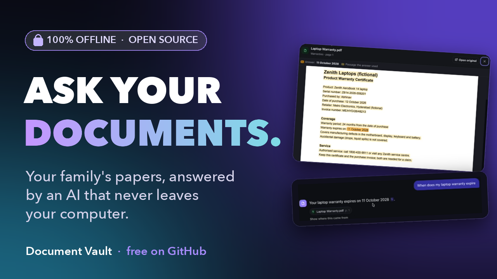
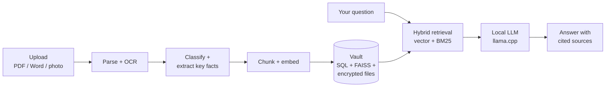

<div align="center">

# Document Vault

**A private, local-first vault for your family's important papers. Ask questions about them in plain English.**

[](https://github.com/Abhinavchitturi/Document-vault/actions/workflows/ci.yml)


-444444)




</div>

Insurance policies, warranty cards, bills, property papers and ID cards: upload them once, then ask.
Document Vault answers from your own documents, cites the exact page, and runs every model on your own computer.
Nothing is sent to a cloud AI service.

> **You:** When does my bike insurance expire?<br>
> **Vault:** Your bike insurance expires on **14 March 2027** [1].<br>
> *[1] Bike Insurance 2026.pdf, page 1 (click to open the page with the answer highlighted)*

## ⬇️ Download

| Device | Download | Requires |
|:---:|:---:|:---:|
| 💻 **Mac** | [**DocumentVault-macOS.dmg**](https://github.com/Abhinavchitturi/Document-vault/releases/latest/download/DocumentVault-macOS.dmg) | macOS 14 or later, Apple Silicon |
| 🪟 **Windows** | [**DocumentVault-Setup.exe**](https://github.com/Abhinavchitturi/Document-vault/releases/latest/download/DocumentVault-Setup.exe) | Windows 10 or 11, 64-bit |
| 📱 **Android phone** | [**DocumentVault-Android.apk**](https://github.com/Abhinavchitturi/Document-vault/releases/download/v0.9.0-beta/DocumentVault-Android.apk) | Android 7 or later |

> **Opening it the first time** (only once: the apps aren't signed with a paid Apple or Microsoft certificate yet)
>
> **Mac:** open Document Vault from Applications. If macOS says it can't check the app, click **Done**, then open
> **System Settings → Privacy & Security**, scroll all the way down (past the list) to *Security* and click **Open Anyway** next to "Document Vault",
> then **Open Anyway** again. (The DMG window shows these steps too.)
>
> **Windows:** if *"Windows protected your PC"* appears, click **More info → Run anyway**.
>
> After that it opens normally, and updates install from inside the app.

**Beta.** Native apps: SwiftUI on the Mac, WinUI on Windows, both following Apple's design. They keep the vault on your
computer and talk to it over a private pipe, with no network port. The phone app pairs with the vault on your computer.

**Installing:** run `DocumentVault-Setup.exe` on Windows, or open the DMG and drag Document Vault to Applications on a
Mac. Both are just the app: nothing else is installed (no Git, Node, Python, Homebrew or Terminal) and no
administrator rights are needed. The first question is how this computer uses the vault:

- **Keep the vault on this computer** (the centre): the app downloads the vault's engine once, with a progress bar (its
  own private Python and the scan reader, checked against a fingerprint built into the app). Then, in the background,
  it downloads the search model and the private AI (about 5 GB, once) by itself, with a progress bar at the top: the
  app works meanwhile, and the assistant answers as soon as the AI is there. It needs about 7 GB of free space.
  The private AI fits the computer's memory: 16 GB or more gets the full model; a laptop with 8 GB gets a smaller one
  (about 2 GB, so the rest of the computer stays quick); below 6 GB there's no private AI, and search still finds
  everything. Adding a document never waits for the AI: it's filed straight away, and the AI takes a closer look at its
  dates and amounts in the background.
- **Use the vault on another computer**: nothing else is downloaded and nothing is stored on this computer.

The vault takes PDFs, Word (.docx) files, photos (JPEG, PNG, HEIC, WebP, TIFF) and text files. Zip, 7-Zip, RAR and other
archives aren't taken: unzip them first and add the documents inside.

**Updates:** the apps check for a new version when they open and every few hours. *Update* downloads it, checks it
against the fingerprint GitHub publishes, installs it and reopens. The heavy engine is downloaded again only when it
changed, which is rare: the vault's own code travels with the app.

Your documents are kept apart from the program (`%LOCALAPPDATA%\Document Vault\Vault` on Windows,
`~/Library/Application Support/Document Vault/Vault` on a Mac), so updating or uninstalling never touches them.

All versions: [Releases page](https://github.com/Abhinavchitturi/Document-vault/releases).

## Highlights

- **Ask, don't search.** A chat that answers from your documents and cites the exact page, with the answer highlighted on the original.
- **Fully local.** Embeddings (Snowflake Arctic Embed), answers (Llama 3.1 8B in llama.cpp, started by the vault itself) and OCR (Tesseract) run on your machine. No separate AI app to install. The LLM client refuses non-local addresses, and the web app loads nothing from the internet.
- **Hybrid retrieval.** Vector search and BM25 keyword search are fused with Reciprocal Rank Fusion, so both *"when does my bike cover end"* and *"find policy KMI/PC/25/0093318"* work.
- **Reads scans and photos.** Auto-rotation, clean-up, English and Hindi OCR, locked PDFs (e-Aadhaar, e-PAN) and HEIC photos.
- **Understands what it stores.** Documents are sorted by type, and expiry dates, due dates, amounts and reference numbers are extracted automatically.
- **Reminders.** Before expiries and due dates: phone notifications, desktop notifications on the Mac, a calendar file and a dashboard.
- **Encrypted at rest.** AES-256-GCM for files, scans, the search index, file names and ID numbers. The key is kept in the macOS Keychain or Windows Credential Manager, with a paper recovery key.
- **Automatic backups.** Scheduled encrypted backups to several places at once (second disk, USB drive, NAS share, cloud-synced folder). Every copy is re-opened and verified.
- **Family-ready.** Password and passkey (Touch ID / Face ID) sign-in, per-person accounts, private or shared documents, and an activity log.
- **Web and phone.** A Next.js web app, and a Flutter phone app paired by QR code over HTTPS with certificate pinning. Works on home Wi-Fi, or from anywhere through a private Tailscale tunnel.

## How it works



| Layer | Technology |
|---|---|
| Backend | Python, FastAPI |
| Web app | Next.js, React, TypeScript (static export served by FastAPI) |
| Mobile | Flutter |
| Embeddings and search | Snowflake Arctic Embed, FAISS, BM25 with Reciprocal Rank Fusion |
| Answers | llama.cpp (`llama-server`) with Llama 3.1 8B, started by the vault itself |
| OCR | Tesseract (English and Hindi) |
| Storage | SQLite (default) or PostgreSQL for records, FAISS for vectors, encrypted files on disk |
| Security | AES-256-GCM, macOS Keychain / Windows Credential Manager, scrypt, passkeys (WebAuthn) |

The answer model is Meta's [Llama 3.1 8B Instruct](https://huggingface.co/meta-llama/Llama-3.1-8B-Instruct) (as a
[GGUF file](https://huggingface.co/bartowski/Meta-Llama-3.1-8B-Instruct-GGUF), under the Llama 3.1 Community License),
run by a pinned [llama.cpp](https://github.com/ggml-org/llama.cpp) build. Both are downloaded from their publishers and
checked against published checksums; neither is redistributed here.

## Getting started

### macOS

Install [Homebrew](https://brew.sh), then run:

```bash
curl -fsSL https://raw.githubusercontent.com/Abhinavchitturi/Document-vault/main/install.sh | sh -s -- --with-samples
```

It downloads the vault to `~/Document-Vault`, sets everything up (AI models included), starts it and opens it.
`--with-samples` loads fictional sample documents so you can try it straight away. Run it again any time to update.

### Windows (beta)

Use [DocumentVault-Setup.exe](https://github.com/Abhinavchitturi/Document-vault/releases/latest/download/DocumentVault-Setup.exe)
(above). For the browser version or development, there is also a one-command setup in PowerShell:

```powershell
& ([scriptblock]::Create((irm https://raw.githubusercontent.com/Abhinavchitturi/Document-vault/main/install.ps1))) -WithSamples
```

That one is for developers: it installs Git, Python, Node and Tesseract through `winget` and then does the same as on
the Mac. The app's installer needs none of them. The Windows version is tested automatically on Windows in CI but has had far less
real-world use. Not on Windows yet: desktop pop-up reminders (phone reminders and the calendar file work).

### Phone (Android and iPhone)

1. On the computer, open **Settings → Phones → Pair a phone**: it shows a QR code.
2. On the phone, open the Document Vault app ([build it](mobile/README.md) for now) and tap **Scan pairing code**.

### One computer as the centre, others connected

Keep the vault on one computer (the centre) and use it from your other laptops, like phones do:

1. On the centre, open Document Vault → **Settings → Connect another computer or phone → Show a code**. It shows a
   one-time code (for example `K7QF-2M9X`, valid for 10 minutes), the computer's address and a security code.
2. On the other laptop, install the app and choose **Connect to the vault on another computer** on its first start (it doesn't
   need the AI download for this). Type the address and the code.
3. Check that the security code it shows matches the centre's screen, then confirm.

The laptop then works with the centre's documents over your Wi-Fi, or from anywhere with Tailscale (below). Nothing is
stored on the laptop, and the connection only trusts the centre's own certificate. The centre has to be on, with
Document Vault open. Either computer can switch roles later in Settings.

### One vault on several computers

Keep the same vault on two (or more) computers, so it doesn't matter which one is off.

**On the computer that already has your documents**

1. Open **Settings → Computers That Keep This Vault → Add a Computer That Also Keeps This Vault** (Mac: the gear at the
   bottom of the sidebar, or ⌘,).
2. It shows a one-time **code** (for example `6FBD-GXJB`, valid for 10 minutes), this computer's **address** and a
   **security code**. Leave it on screen.

**On the other computer** (Document Vault installed, and its vault still has no documents)

3. Open **Settings → Computers That Keep This Vault → Join a Vault Kept on Another Computer**.
   - On a fresh install you can also do it straight away: choose **Keep the vault on this computer**, then on the
     sign-up screen **Join a vault kept on another computer instead**.
4. Type the **address** and the **code** from step 2, then **Join**.
5. Check that the **security code** it shows matches the first computer's screen, then **It matches**. If it doesn't
   match, cancel: something else answered at that address.
6. It copies the vault, with a progress bar: documents with their search data, family members and their passwords,
   paired laptops and phones.
7. Sign in with the **same name and password** as on the first computer. (If you had already signed up on this
   computer, the joined vault's name and password take over.)

Both computers need Document Vault open and to be able to reach each other: the same Wi-Fi, or Tailscale (below).
Settings then lists both computers and when each was last up to date.

From then on the computers keep each other up to date within seconds whenever they can reach each other: adding,
re-filing, editing and deleting on either one. A deletion stays a deletion; if both changed the same document while
apart, the newer change wins. Connected laptops learn every computer that keeps the vault and use whichever one is on.
The vault's encryption key only travels to a computer paired with the code and security code, over the encrypted
connection between the two, never through any server. Each computer downloads its own private AI.

Good to know: only a computer whose vault has no documents can join another (nothing of its own is mixed in); phones
stay with the computer they were paired with; with three or more computers, each catches up through the one it joined.

### Use it from anywhere with Tailscale

At home, the phone reaches the vault over your Wi-Fi. To use it anywhere else (on mobile data, at work, travelling),
connect your devices with [Tailscale](https://tailscale.com), a free private network between your own devices:

1. Install Tailscale on the **computer** ([tailscale.com/download](https://tailscale.com/download)) and sign in.
2. Install Tailscale on the **phone** (App Store or Play Store) and sign in with the **same account**.
3. Leave Tailscale switched on on both. Pair the phone as above (or, if it is already paired, open the app once on home
   Wi-Fi): it learns the computer's Tailscale address, and uses it whenever home Wi-Fi isn't there.

Traffic between your devices is end-to-end encrypted by Tailscale (WireGuard), and the vault adds its own HTTPS with
the app pinned to the vault's certificate. Nothing is opened to the public internet, and Tailscale's servers only
introduce your devices to each other: they cannot read the traffic. The computer has to be on and the vault running.
`./vault status` shows whether Tailscale is connected.

### First steps

Open **http://localhost:8000**, choose a password, and ask *"When does my bike insurance expire?"*. The first run
downloads the embedding model (about 440 MB); after that everything works offline.

To try an upload, drag `samples/upload-demo/Laptop Warranty.pdf` onto the **Upload** page and ask
*"When does my laptop warranty expire?"*. The locked e-Aadhaar sample uses the password `ARJU1988`.

<details>
<summary><b>Install from source, step by step</b></summary>

```bash
git clone https://github.com/Abhinavchitturi/Document-vault.git && cd Document-vault

# 1. Python packages
python3 -m venv venv && source venv/bin/activate
pip install -r requirements.txt

# 2. Tesseract (scans and photos) and Node (builds the web pages)
brew install tesseract tesseract-lang node

# 3. The local AI: llama.cpp and the answer model (about 5 GB, checked against published checksums)
python -m backend.llm.setup

# 4. Build the web app
cd frontend && npm install && npm run build && cd ..

# 5. Load the sample documents into a single-file database (no PostgreSQL needed)
export VAULT_DATABASE_URL=sqlite:///data/index/vault.db
python -m backend.upload.ingest samples/pdfs samples/scans --owner "$USER"

# 6. Start the vault
./vault start
```

**Linux:** install Tesseract with your package manager, run steps 1, 3, 4 and 5, then start the server
with `python -m backend.api.app --phones`. The key is then kept in `~/.document-vault/keys/`. Not tested.

</details>

<details>
<summary><b>Everyday commands and troubleshooting</b></summary>

Run these from the vault folder (`~/Document-Vault`, or `%USERPROFILE%\Document-Vault` on Windows, where the
command is `vault` instead of `./vault`).

| Command | What it does |
|---|---|
| `./vault start` / `stop` | Start or stop the vault in the background |
| `./vault status` | Check the database, the local AI, OCR, web pages and phone tunnel |
| `./vault logs` | Show the log (`-f` to follow) |
| `./vault update` | Pull changes, rebuild what changed, restart |
| `./vault autostart on` | Start when you log in |

| Symptom | Fix |
|---|---|
| Header says **Assistant offline** | Run `python -m backend.llm.setup --check`; if anything is missing, `python -m backend.llm.setup` downloads it |
| Scans or photos fail, or are "hard to read" | Install Tesseract: `brew install tesseract tesseract-lang` (Windows: `winget install UB-Mannheim.TesseractOCR`) |
| Web pages missing at `localhost:8000` | Build the web app: `cd frontend && npm install && npm run build` |
| Want a clean start | `./vault stop`, delete the `data/` folder, load the samples again and `./vault start` |

</details>

## Privacy and security

- **Local only.** No document text, question or embedding leaves your computer. The LLM client refuses non-local addresses.
- **Encrypted on disk.** Without the key, a copy of `data/` is unreadable. The key lives in the system keychain, never in the vault folder.
- **Recovery.** A paper recovery key, and single-file encrypted `.dvbackup` backups that restore on a new computer.
- **Accounts.** Passwords stored only as salted scrypt hashes, HttpOnly SameSite cookies, lockout after repeated failures, passkey sign-in.
- **Phones.** Paired by QR code and served over HTTPS, with the app pinned to the vault's own certificate. Remote access goes through Tailscale; nothing is exposed to the public internet.
- **Activity log.** Sign-ins, document access and changes, recorded without the words you typed.

This repository holds code and fictional samples only. Your own documents live in `data/`, which is git-ignored.

## Backups and disk failures

- **Automatic backups:** *Settings → Security → Automatic backups* (admin). Choose up to five locations, daily or
  weekly, and how many backups to keep. Each location's last result, or the reason it failed, is shown there.
- **Where to keep them:** a second disk, a USB drive, a NAS share mounted on the computer (for example
  `/Volumes/NAS/Backups`), or a cloud-synced folder such as iCloud Drive or Dropbox. Every location only ever holds
  encrypted files. Settings warns when two locations share a disk, or one shares the vault's disk.
- **Every copy is verified.** Each copy is read back and fully decrypted after writing. A bad copy is removed and
  reported, and older backups are only pruned once a good one exists. One location failing does not stop the others.
- **Restore** on any computer: `python -m backend.security.cli restore "<file>.dvbackup"`.
  Check a file without restoring it: `python -m backend.security.cli verify "<file>.dvbackup"`.

The live vault stays on the computer's own disk (SQLite is not safe on a network share). Backups are not live
replication: you can lose up to one backup interval of changes, so keep at least one backup on another device.

## Search quality

Measured on the bundled sample set (13 documents, 32 questions, 8 of them lookups by a policy or serial number):

| Method | Recall@1 | Recall@3 | MRR@5 |
|---|---|---|---|
| Vector only (Arctic Embed M v1.5) | 0.906 | 1.000 | 0.948 |
| Keyword only (BM25) | 0.938 | 1.000 | 0.969 |
| **Hybrid (default)** | **1.000** | **1.000** | **1.000** |

Reproduce with `python -m backend.eval.evaluate --show-misses`. The sample set is small and synthetic, so treat
these numbers as a sanity check rather than a benchmark.

## Project layout

| Path | Contents |
|---|---|
| `backend/` | FastAPI app, upload pipeline, parsing and OCR, classification, key-fact extraction, hybrid retriever, local LLM client, auth, security, backups, reminders |
| `frontend/` | Next.js web app |
| `mobile/` | Flutter phone app ([setup](mobile/README.md)) |
| `packaging/` | The macOS app and DMG, the Windows installer, and their icons |
| `samples/` | Fictional documents, scans, questions and the generators for them |
| `tests/` | Test suite |
| `docs/` | [User guide](docs/USER_GUIDE.md), [how it works](docs/HOW_IT_WORKS.md), [project brief](docs/PROJECT_BRIEF.md) |

## Development

```bash
pytest -q                          # tests use a fake embedder and LLM: no models needed
python -m backend.api.app          # API on :8000
cd frontend && npm run dev         # web app on :3000, forwarding /api to :8000
```

`packaging/` holds interim installers (a DMG launcher and an Inno Setup installer, built by [CI](.github/workflows/ci.yml));
they are not published while the native apps are being built.

## Roadmap

Built in 13 phases, from a core RAG engine to a mobile app with family sharing; see the
[user guide](docs/USER_GUIDE.md#status). Since then: automatic verified backups, one-command installers, Windows
support, and llama.cpp so no separate AI app is needed.

Now: native apps, one by one: **macOS** (SwiftUI), then iPhone (SwiftUI), Android (Jetpack Compose) and Windows
(WinUI). On the desktop the native app runs the vault's engine as a private helper, with no network port; phones
connect over Wi-Fi or Tailscale.

## License

Released under the [MIT License](LICENSE).
